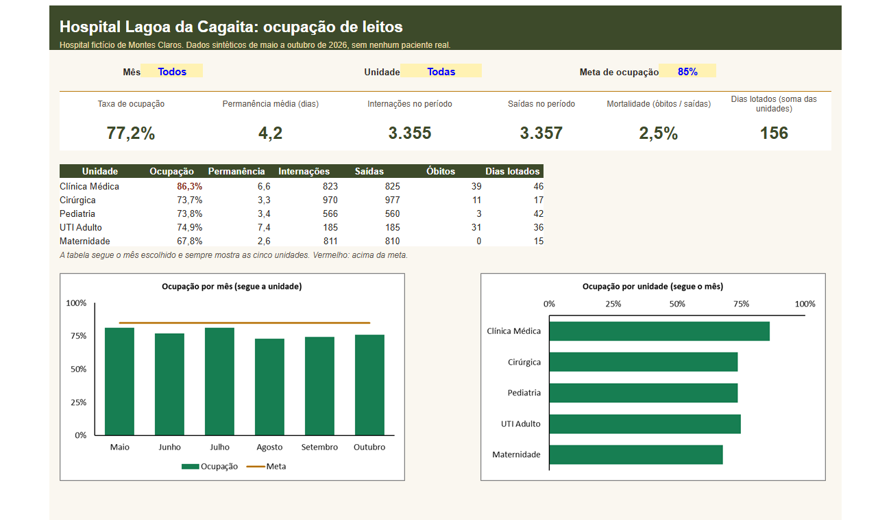

# Painel de ocupação de leitos | Excel 2016

[Baixar a planilha](painel_leitos.xlsx) · [Ver o painel](prints/painel.png)

Qual unidade concentra a maior ocupação, e em que mês? No hospital simulado, a ocupação geral em seis meses foi de **77,2%**, enquanto a **Pediatria chegou a 90,1% em julho**. O painel permite comparar recortes sem depender apenas da média geral.

## Método e estrutura

**Excel 2016 · Python · openpyxl · CSV**

A planilha usa um censo diário à meia-noite. A ocupação divide os pacientes-dia pelos leitos-dia disponíveis no recorte. O denominador acompanha as mudanças de capacidade ao longo do tempo.

- [Base sintética](dados/): internações e capacidade por período.
- [Planilha](painel_leitos.xlsx): indicadores, gráficos e filtros por unidade e mês.
- [Conferência em Python](conferir.py): compara ocupação, internações e saídas do consolidado com os valores salvos no Excel.
- [Scripts](scripts/): geração da base e da planilha, estilo e recálculo.

## Como reproduzir

Para ver os indicadores, abra a planilha no Excel 2016 ou posterior. Para conferir o consolidado da cópia publicada:

~~~sh
git clone https://github.com/L1c0/painel-leitos-hospitalares.git
cd painel-leitos-hospitalares
python -m pip install -r requirements.txt
python conferir.py
~~~

Para gerar e recalcular do zero, use Windows com Excel instalado:

~~~powershell
python scripts/gerar_dados.py
python scripts/planilha.py
python scripts/recalcular.py painel_leitos.xlsx
python conferir.py
~~~

Não exige variáveis de ambiente.

## Escopo e licença

Protótipo de estudo desenvolvido com apoio de IA generativa. Não contém dados de pacientes reais nem acompanha transferências entre unidades. A mortalidade bruta não deve ser usada para comparar unidades diferentes.

[MIT](LICENSE)
